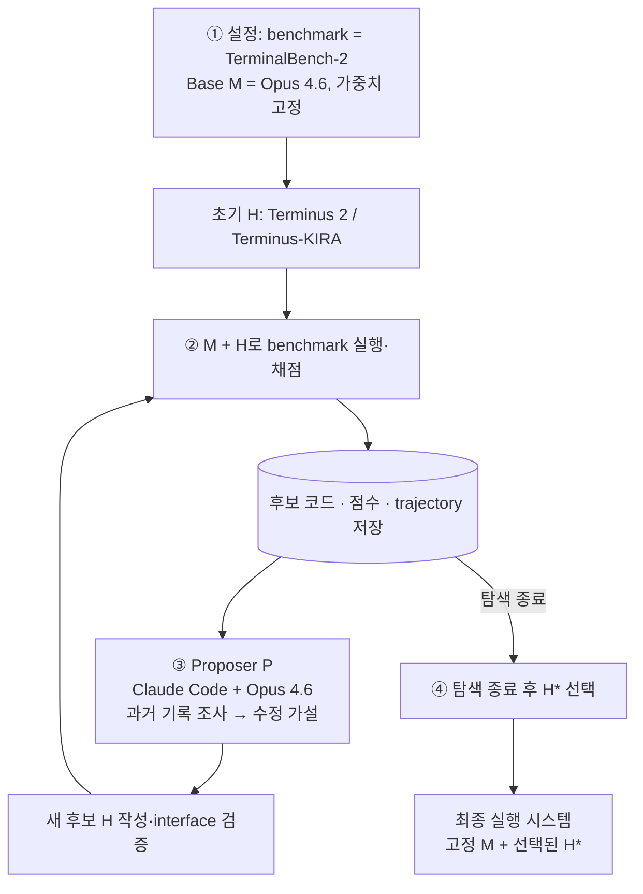
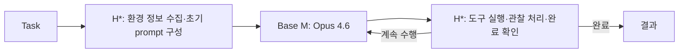

## 문제와 배경

### 배경과 읽는 관점

Agent가 긴 작업에서 실패했을 때 점수 하나만으로는 원인을 알기 어렵다. 메모리에 무엇을 남겼는지, 어떤 검색 결과를 버렸는지, 어느 시점에 종료했는지까지 되짚어야 할 수 있다. Meta-Harness는 이런 개발자의 진단 과정을 자동화하려면, 수정 agent가 과거의 코드와 실행 결과를 다시 조사할 수 있어야 한다는 데서 출발한다.

### 기존 접근과 연구 질문

LLM의 성능은 가중치뿐 아니라 **어떤 정보를 기억하고, 언제 검색하며, 모델에게 무엇을 보여 주는가**에 달려 있다. 이를 구현한 프로그램이 harness다. 같은 모델을 두고도 harness를 사람이 수정하면서 큰 성능 차이를 만들 수 있다면, 이 개발 과정 자체를 자동화할 수 있는지가 논문의 출발점이다(§1).

저자들이 겨냥하는 병목은 **feedback interface**다. Harness의 메모리 저장 규칙 하나가 여러 단계 뒤 retrieval과 최종 답에 영향을 줄 수 있다. 점수는 실패했다는 사실을 알려 주지만, 어떤 이전 결정이 실패에 기여했는지 설명하지 못한다. 요약도 미리 중요하다고 판단한 정보만 남기므로, 나중에 새로운 원인 가설을 조사할 때 필요한 세부 정보를 잃을 수 있다는 주장이다(§1–2).

따라서 제안은 긴 로그를 전부 context에 넣는 것이 아니다. **원본 경험을 외부에 보관하고, agent가 필요한 부분을 직접 찾아 읽게 한다.** 여기서 검색 대상은 일반 지식 문서가 아니라 과거의 프로그램과 그 실행 결과다. 한 번의 harness 평가에서 최대 10M tokens의 진단 정보가 생성될 수 있다는 설명도, proposer가 매번 10M tokens를 입력받는다는 뜻은 아니다(§1, Table 1).

핵심은 과거 로그를 많이 보관하는 것과 그것을 매번 전부 입력하는 것이 다르다는 점이다. 이 글에서는 수정 agent에게 어떤 기록이 열려 있는지, 누가 무엇을 진단하는지, 검색용 경험 저장소와 개별 task의 memory가 어떻게 다른지를 나눠 살펴본다.

## 핵심 아이디어

### 먼저 직관으로 이해하기

고정된 요약을 유일한 피드백으로 쓰는 대신, 코드·점수·trace를 외부 filesystem에 남기고 proposer가 현재 가설에 필요한 부분을 선택적으로 읽게 한다. 새 harness를 실행한 결과도 같은 저장소에 추가되므로, 이후 수정은 가장 최근 후보뿐 아니라 과거의 성공·회귀와 구현을 다시 근거로 삼을 수 있다.

전체 구조: [Figure 2 — Meta-Harness search loop](#figure-autoharness_v3).

<figure id="figure-autoharness_v3">
  <a href="/images/posts/meta-harness/autoharness_v3.png"></a>
  <figcaption>Figure 2 — Meta-Harness search loop · 출처: <a href="https://arxiv.org/abs/2603.28052v1">원논문</a></figcaption>
</figure>

### 문제를 푸는 모델과, 문제 풀이 절차를 고치는 agent

| 구성 요소 | 역할 | 탐색 중 바뀌는 것 |
|---|---|---|
| Base model M | 주어진 harness의 prompt·tool 흐름에 따라 task 수행 | 가중치 고정 |
| Harness H | memory, retrieval, prompt construction, orchestration 구현 | Python 코드 |
| Proposer P | 과거 코드를 조사하고 실패를 진단해 새 harness 작성 | 후보 코드 생성; 별도 weight training은 제시하지 않음 |
| Evaluator | interface 검증, task 실행, 점수와 trace 기록 | 후보마다 평가 결과 추가 |
| Filesystem D | 모든 이전 후보의 코드·점수·trace 보관 | 탐색 동안 계속 증가 |

실험의 proposer는 **Claude Code + Opus 4.6**, 탐색 대상은 **single-file Python program**이다. Domain별 skill에는 파일 위치, 명령, 출력 형식, 수정 가능·불가능한 파일을 적는다. 구체적으로 어떤 실패를 분석하고 어떤 설계를 시도할지는 proposer가 결정한다(§3).

### 한 iteration에서 하는 일

1. 초기 baseline harness들을 실행하고 코드·점수·trace를 저장한다.
2. Proposer는 task prompt·domain skill로 기록의 경로와 분석 과제를 받고, Claude Code session 안에서 `Read`·`Grep`·`Bash`(예: `grep`, `cat`) tool call을 선택해 이전 기록을 조사한다. 가장 최근 후보나 점수가 가장 높은 후보만 볼 필요는 없다. [공개 코드로 본 구체적 조사 과정](#code-walkthrough).
3. 진단에 따라 retrieval·memory·prompt·control flow 등을 수정한 후보 k개를 작성한다.
4. Interface validation을 통과한 후보를 평가한다.
5. 새 후보와 평가 기록을 저장하고 다음 iteration으로 간다.
6. 정해진 탐색 횟수가 끝나면 평가된 후보의 Pareto frontier를 반환한다(Algorithm 1).

후보 population과 Pareto frontier는 유지하지만 **강제된 parent selection rule은 없다.** 기존 후보의 일부를 고칠지, 여러 성공 사례를 합칠지, 크게 다시 쓸지까지 agent에게 맡긴다. 본문은 일반적인 run을 약 20 iterations·60 harnesses로 설명하지만, 실제 후보 수는 domain별로 다르다(§3–4).

### 서로 다른 두 종류의 memory

**Outer-loop 경험 저장소**는 탐색 중 모든 후보의 코드와 실행 로그를 남기는 filesystem이다. **Inner harness의 memory**는 발견된 프로그램이 개별 task 수행에 쓰는 상태다. 예를 들어 online classification harness는 순차적으로 받은 labeled example을 저장한다. 두 memory는 역할과 수명이 다르다(§2–3, §4.1, App. B.1).

분류·수학에서는 proposer에게 search-set 결과만 제공하고 test 결과는 마지막 평가까지 감춘다. TerminalBench-2는 별도 held-out task split을 만들지 않는 예외다(§3, §4.3).

### Base model의 사후 reflection과 proposer의 진단은 구분한다

Meta-Harness의 공통 loop에는 **base model이 episode 종료 후 최종 reward·trace를 다시 받아 reflection을 작성·축적하는 고정 단계가 없다.** 평가 코드가 코드·점수·trace를 저장하고, proposer가 다음 후보를 만들 때 과거 기록을 조사해 실패를 진단한다. App. A.2의 회귀 원인 가설은 **proposer의 recorded reasoning**이다(§3, Algorithm 1, App. A.2, D).

이는 후보 harness 내부에서 reflection·memory·verification을 사용할 수 없다는 뜻은 아니다. ACE의 reflective memory, 분류 variant의 draft verification, TerminalBench의 completion checklist는 domain별 내부 절차다. 이들을 공통 outer loop의 reward 기반 post-episode reflection과 동일시해서는 안 된다. 자세한 구분은 [Q&A](#qa-notes)에 기록했다.

공개 코드 확인으로 보완하면, **원본 기록만 존재하는 것은 아니다.** TerminalBench history에는 proposer의 hypothesis·changes가 남고, 분류용 skill Step 0은 누락된 과거 iteration의 post-eval report(30줄 이하)를 proposer에게 작성하게 한다. 이는 base model의 사후 reflection과 다르다. 원본을 계속 열람할 수 있으면서 proposer의 해석도 축적하는 구조다. 공개 release의 세부 skill은 논문 당시 설정과 같다고 가정하지 않는다([코드 해설 §6–7](#code-walkthrough)).

### 정의와 수식

고정된 모델 M, task 분포 X, harness H를 실행했을 때의 trajectory τ에 대해 목표는 다음과 같다(§3).
$$
H^*=\arg\max_H\mathbb E_{x\sim\mathcal X,\;\tau\sim p_M(H,x)}[r(\tau,x)].
$$
바꾸는 변수는 모델 가중치가 아니라 **실행 프로그램 H**다. 모델의 출력뿐 아니라 harness가 구성한 context와 state update도 trajectory에 영향을 준다. 정확도와 context cost를 함께 고려할 때는 어느 한쪽에서도 다른 후보에 뒤지지 않는 **Pareto frontier**를 보고한다.

이 목적식의 reward를 gradient로 역전파하거나 proposer를 RL로 학습하는 알고리즘은 제시하지 않는다. 코드 후보를 작성하고 실제로 실행·채점하는 search 절차다(§3, Algorithm 1).

## 실험과 핵심 결과

### 실험 설정

| 항목 | Online text classification | Retrieval-augmented math | Agentic coding |
|---|---|---|---|
| Base model | GPT-OSS-120B | 탐색 GPT-OSS-20B; 평가 총 5개 모델 | Opus 4.6, Haiku 4.5 |
| Task | USPTO-50k, Symptom2Disease, LawBench | OlympiadBench + Omni-MATH hard에서 탐색; IMO 수준 200문항 평가 | TerminalBench-2 89 tasks |
| 초기 후보 | Zero-shot, few-shot, ACE, MCE | Zero-shot, few-shot, ACE | Terminus 2, Terminus-KIRA |
| 탐색 규모 | 20 iterations × 2 = 40 candidates | 40 iterations, 109 candidates | App. A는 Opus 4.6의 10-iteration run 분석 |
| 최종 평가와의 분리 | Held-out test + 추가 OOD 9 datasets | Search와 다른 문제 + 추가 4개 모델 | 탐색·평가에 같은 89 tasks 사용 |
| 주요 metric | Accuracy, 추가 input context | 문제당 3 samples로 평균한 pass@1 | Pass rate |

근거: §4.1–4.3, App. A, C. 분류에서는 labeled example이 순차적으로 주어지고 harness가 memory를 갱신한다. LawBench는 215 classes, Symptom2Disease는 22 classes, USPTO는 180 classes다.

#### Train·validation의 두 수준

분류의 labeled train examples는 inner harness의 memory/state를 갱신한다. Search/val 점수와 기록은 outer-loop proposer가 **harness 코드를 수정·선택**하는 데 쓴다. Test는 탐색에서 분리한다. 공개 분류 코드는 train/val/test를 구분하고 `finalize_run()`에서 탐색을 동결한 뒤 test를 평가한다. 수학은 search/test를 분리하며, TerminalBench-2는 같은 89 tasks를 탐색·평가에 사용한다. 여기서 데이터셋 validation과 앞서 말한 interface validation은 다른 개념이다([관련 Q&A](#qa-notes)).

분류 optimizer 비교는 proposer를 Opus 4.6 max reasoning으로 맞추고 **harness 평가 횟수**를 같은 예산으로 둔다. TTT-Discover는 전체 학습 절차가 아니라 text-optimization의 PUCT reuse rule만 사용한다. GEPA·Best-of-N·OpenEvolve도 비교한다(§4.1, Table 4).

수학 retrieval corpus는 8개 dataset의 **535,356문제**다(Table 10). Exact prefix와 fuzzy Jaccard 0.8 기준으로 search·evaluation 문제와 중복을 제거했다고 설명한다. Runtime에는 풀이가 비어 있지 않고 4,000 characters보다 짧은 항목을 쓰며, prompt에 넣는 풀이는 3,000 characters로 자른다(App. C.2). Test 200문항은 IMO-AnswerBench 100, IMO-ProofBench 60, ArXivMath 2025-12 17, 2026-01 23이다(Table 11).

**원문 설정의 불일치**: 수학 search set은 §4.2에서 250문항, App. D의 구현 팁에서는 88문항으로 쓰여 있다. 두 수치의 관계는 명확히 설명하지 않는다. 위 표는 주 실험을 기술한 §4.2를 따른다. 재현 시 확인이 필요하다.

### Finding 1 — 원본 trace 접근이 분류 harness 탐색에 큰 차이를 만든다

정보 접근을 제한한 ablation이다. **Scores Only도 코드와 점수를 볼 수 있다.** 아래 차이를 코드 접근 유무의 차이로 읽으면 안 된다(§4.1, Table 3).

| Proposer가 볼 수 있는 정보 | Median accuracy | Best accuracy |
|---|---:|---:|
| 코드 + 점수 | 34.6 | 41.3 |
| 코드 + 점수 + LLM summary | 34.9 | 38.7 |
| 코드 + 점수 + 원본 execution trace | **50.0** | **56.7** |

저자들은 full interface의 median이 다른 조건의 best보다도 높다는 점을 강조한다. Summary가 진단 정보를 회복하지 못한다는 해석을 제시한다. 이 수치는 아래 최종 test accuracy 48.6과 구분해야 한다. 표의 Median을 여러 독립 search seed의 최종 성능 중앙값으로 볼 근거도 제시하지 않는다.

Optimizer 비교의 **search-set** Median / Best는 GEPA 32.6 / 40.2, Best-of-N 34.0 / 44.2, OpenEvolve 39.1 / 43.3, TTT-Discover 34.1 / 45.6, Meta-Harness **50.0 / 56.7**이다(Table 4). Figure 4는 기존 두 optimizer의 최종 수준에 첫 4 evaluations 안에 도달했다고 설명한다.

그림: [Figure 4 — optimizer별 search progress](#figure-learning_curves). 논문의 약 10× 효율 주장은 **full evaluation 횟수**에 관한 것이다. 총 API 비용이나 wall-clock의 10× 절감을 측정한 결과는 제시하지 않는다.

<figure id="figure-learning_curves">
  <a href="/images/posts/meta-harness/learning_curves.png"></a>
  <figcaption>Figure 4 — optimizer별 search progress · 출처: <a href="https://arxiv.org/abs/2603.28052v1">원논문</a></figcaption>
</figure>

### Finding 2 — 최종 분류 성능은 올라가면서 추가 context는 줄어든다

다음은 세 dataset의 **held-out test** 결과다(Table 2).

| Harness | USPTO | S2D | Law | Avg accuracy | 추가 context, K tokens |
|---|---:|---:|---:|---:|---:|
| Zero-shot | 12.0 | 63.2 | 7.0 | 27.4 | 0 |
| Few-shot, all | 15.0 | 78.3 | 29.0 | 40.8 | 12.3 |
| MCE | 14.0 | 83.0 | 23.0 | 40.0 | 28.5 |
| ACE | **16.0** | 77.8 | 29.0 | 40.9 | 50.8 |
| Meta-Harness | 14.0 | **86.8** | **45.0** | **48.6** | **11.4** |

평균은 ACE보다 **+7.7%p**이고 context는 논문 표현으로 약 4× 적다. 그러나 USPTO에서는 ACE보다 낮다. 모든 dataset에서 일관되게 이기는 결과는 아니다.

발견된 대표 정책 **Label-Primed Query**는 한 번의 model call에 다음을 구성한다(App. B.1, Figure 6).

- 가능한 label 목록을 먼저 제시한다.
- 각 label마다 현재 query와 관련된 대표 example을 하나씩 넣는다.
- TF-IDF로 찾은 비슷하지만 label은 다른 example들을 contrastive pair로 보여 준다.

저비용 대안 **Draft Verification**은 유사 example 5개로 draft label을 만든 뒤, 그 label을 지지하는 example 5개와 다른 label의 example 5개를 찾아 두 번째 call에서 확인한다. Memory가 5개 미만이면 single-call few-shot으로 돌아간다. 이 variant의 test 평균은 40.1%, context는 5.4K **characters**다(Table 9).

**단위 주의**: Table 2의 11.4는 K **tokens**, Table 9의 같은 최종 variant에 적힌 45.5는 K **characters**다. Table 9를 tokens 표로 옮기면 안 된다.

그림: [Figure 3 — accuracy/context frontier](#figure-classification-pareto-5-ours). Figure 5·6은 별도 figure PDF 없이 [부록 LaTeX](https://arxiv.org/src/2603.28052)에 TikZ로 들어 있다.

<figure id="figure-classification-pareto-5-ours">
  <a href="/images/posts/meta-harness/classification-pareto-5-ours.png"></a>
  <figcaption>Figure 3 — accuracy/context frontier · 출처: <a href="https://arxiv.org/abs/2603.28052v1">원논문</a></figcaption>
</figure>

### Finding 3 — 분류에서는 새 dataset으로, 수학에서는 새 문제와 모델로 전이한다

분류 OOD 평가는 SciCite, FiNER, Amazon Reviews, Financial PhraseBank, GoEmotions, Banking77, AG News, SciTail, TweetEval-Hate의 9개 dataset이다. 평균 정확도는 Zero-shot **67.0**, Few-shot 32 **69.6**, ACE **70.2**, Meta-Harness **73.1**이다. Meta-Harness는 6/9 dataset에서 최고이거나 공동 최고이며, FiNER·Financial PhraseBank·Banking77에서는 최고가 아니다(Table 5).

수학은 **GPT-OSS-20B로 고른 하나의 harness**를 다른 문제와 모델에도 그대로 사용한다. 다음 수치는 문제당 3 samples로 평균한 pass@1이며, 세 번 중 하나라도 맞으면 성공으로 세는 pass@3가 아니다(§4.2, Table 6).

| Retrieval | GPT-5.4 nano | GPT-5.4 mini | Gemini-3.1 Flash-Lite | Gemini-3 Flash | GPT-OSS-20B | Avg |
|---|---:|---:|---:|---:|---:|---:|
| 없음 | 23.0 | 28.8 | 28.6 | 42.6 | 47.6 | 34.1 |
| Dense, k=5 | 31.1 | 28.3 | **37.1** | **47.2** | 46.7 | 38.1 |
| BM25 | 30.2 | 29.2 | 32.8 | 46.6 | 48.9 | 37.5 |
| Meta-Harness | **31.7** | **30.4** | 34.9 | 46.3 | **50.6** | **38.8** |

검색 없는 baseline보다 평균 **+4.7%p**, BM25보다 **+1.3%p**, Dense k=5보다 **+0.7%p**다. 모든 모델에서 no-retrieval보다 높지만, 각 모델의 최고 fixed retrieval baseline을 전부 이기지는 않는다.

논문은 여러 곳에서 “five held-out models”라고 부르지만 **GPT-OSS-20B는 harness 선택에 사용한 모델**이다. 정확한 구분은 **5개 모델 모두 새 test 문제로 평가했고, 그중 4개 모델이 model 측면에서도 unseen**이라는 것이다(§4.2).

발견된 retrieval program은 BM25 위에 **keyword·regex router와 domain별 규칙**을 추가한다. 여러 route의 답을 ensemble하지 않고 하나를 선택한다(App. B.2, Figure 8).

| Route | 발견된 처리 |
|---|---|
| 조합론 | BM25 20개 → 중복 제거로 8개 → lexical score·난이도로 rerank → 3개 |
| 기하 | 어려운 NuminaMath reference 1개 + raw BM25 neighbor 2개 |
| 정수론 | BM25 12개 → lexical score·난이도·풀이 초반의 기법 명시 여부로 rerank → 3개 |
| 대수·기타 | BM25 10개 → lexical score·난이도로 rerank → 상위 점수 분포에 따라 example 수 조절 |

새 dense encoder를 학습한 결과가 아니라, **같은 lexical retrieval 도구를 사용하는 절차를 탐색한 결과**다.

### Finding 4 — TerminalBench 개선의 대표 수정은 environment bootstrapping이다

| Harness | Opus 4.6 pass rate | Haiku 4.5 pass rate |
|---|---:|---:|
| Claude Code | 58.0 | 27.5 |
| Terminus 2 | 62.9 | 28.3 |
| Terminus-KIRA | 74.7 | 33.7 |
| Goose | — | 35.5 |
| ForgeCode | 81.8 | — |
| Meta-Harness | **76.4** | **37.6** |

근거: §4.3, Table 7. 비교군 수치는 논문에 수록된 값이다.

Opus에서는 Terminus-KIRA보다 **+1.7%p**지만 ForgeCode보다는 낮다. Haiku에서는 표에 수록된 최고 기존 agent인 Goose보다 **+2.1%p**다. 따라서 “모든 수작업 harness를 모든 모델에서 이겼다”는 요약은 부정확하다. 저자들은 ForgeCode의 공개 코드만으로 점수를 재현하지 못했다고 보고한다.

발견된 대표 harness는 Terminus-KIRA의 native tool calling·30KB output cap·completion checklist를 이어받고, **첫 model call 전에 환경 정보를 수집해 초기 prompt에 추가**한다(App. B.3, Figure 9).

수집하는 정보는 working directory, `/app`의 파일 목록, 설치된 언어와 버전, package manager, available memory다. 수집은 15초 timeout을 두며 실패 시 조용히 넘어간다. 약 **80줄**이 추가되고, 저자들은 초반 환경 탐색 2–4 turns를 줄인다고 설명한다. 개선된 7/89 tasks에는 protein-assembly, path-tracing 등이 있으며, 특수 도구의 설치 여부가 중요한 과제라는 공통점을 제시한다.

### Finding 5 — 탐색 로그에는 과거 회귀를 보고 전략을 바꾸는 과정이 나타난다

App. A가 분석하는 10-iteration Opus run에서 proposer는 iteration당 median **82개 파일**을 읽는다(범위 69–99). 유형은 코드 41%, execution trace 40%, score/summary 6%, 기타 13%다(Table 8). 이는 모든 실험을 합친 평균이 아니다.

정성 분석의 흐름은 다음과 같다(App. A.2).

1. 초기에는 terminal marker 제거·loop breaker 같은 수정에 prompt 변경까지 묶었다가 성능이 하락한다.
2. 여러 실패 후보가 공유하는 cleanup prompt를 원인 후보로 지목한다.
3. Prompt를 되돌리고 구조 수정만 남겨 회귀 폭이 줄어드는 것을 관찰한다.
4. 이후 control flow 수정도 계속 실패하자, iteration 7에서 환경 snapshot을 추가하는 방향으로 전환한다.
5. 성공한 추가 수정과 과거 수정을 결합하거나 이전 run의 경험을 참조한다.

저자들은 이를 실패에 대한 causal hypothesis를 세우고 검증하는 행동의 근거로 제시한다. **이 서사의 baseline 64.4%는 Table 7의 Terminus-KIRA 74.7%와 다르다.** 원문은 두 측정의 대응을 충분히 설명하지 않으므로 같은 최종 평가 표에 섞지 않았다.

## 한계와 해석

### 저자들이 밝힌 한계

- **Proposer 범위**: 세 domain을 평가했지만 proposer는 Claude Code + Opus 4.6이라는 강한 한 종류다. 다른 agent에서도 같은 효과가 나는지는 후속 연구로 남긴다(§5).
- **TerminalBench 평가 분리**: 같은 89 tasks에서 search와 최종 평가를 한다. 저자들은 이를 benchmark-specific discovery problem으로 설명하고, task-specific string leakage를 수동·regex로 검사한다(§4.3).
- **가중치와 harness의 공동 진화**: 현재 base model은 frozen이고, weights와 실행 전략을 함께 바꾸는 방법은 future work다(§3, §5).
- **Skill과 evaluator의 설계 필요**: App. D는 skill을 다듬는 것이 iteration 수나 population 크기보다 중요했던 경험을 밝힌다. 좋은 baseline, 어려우면서 빠르게 채점할 search set, query 가능한 로그, 저비용 interface validation, proposer 밖의 자동 evaluator를 권한다. 이를 통제 실험으로 입증한 과학적 결론이 아니라 구현 경험이라고 명시한다.

### AI의 해석

<aside class="note-callout" markdown="1">
**아래는 AI 정리자의 해석이며 원논문의 주장과 구분합니다.**
</aside>

> 아래는 논문의 직접 주장이 아니라 정리자의 해석이다.

1. **차별점은 경험을 읽는 권한과 방식에 있다.** 코드 탐색, 실행 평가, 로그 저장은 기존에도 가능한 구성이다. 이 논문은 무엇을 요약해 전달할지를 미리 정하기보다 proposer가 원본에서 필요한 증거를 찾아가게 하는 interface에 초점을 둔다. “메모리가 많으면 좋다”보다 “새 가설이 생겼을 때 원래 기록을 다시 조사할 수 있는가”라는 질문으로 읽는 편이 구체적이다(§1–3, Table 3).
2. **Full interface의 효과와 filesystem 자체의 효과는 다르다.** Table 3은 원본 trace 접근의 가치를 지지하지만, 동일 정보를 다른 저장소·검색 API로 제공해도 같은 결과가 나는지, full history 중 오래된 기록이 얼마나 필요한지는 분리하지 않는다. Full-history vs recent-history, raw trace vs 동일 token 예산의 retrieval/summary를 추가 비교할 수 있다.
3. **평가 횟수를 맞춘 것이 총 compute를 맞춘 것은 아니다.** Proposer가 얼마나 많은 파일과 tokens를 읽고 얼마나 긴 코딩 과정을 거쳤는지에 따라 탐색 비용이 달라질 수 있다. 11.4K context는 발견된 분류 harness의 input 비용이지 outer-loop search 비용이 아니다. 10× 효율 주장도 full evaluation 횟수의 의미로 제한해 읽어야 한다(§4.1, App. A, D).
4. **일반화의 단위가 실험마다 다르다.** 분류는 새 dataset, 수학은 새 문제와 추가 4개 모델, 코딩은 탐색한 benchmark 안의 성능이다. 세 결과를 하나의 “unseen 환경으로 일반화” 주장으로 묶으면 증거의 범위를 넘는다. Task-specific string audit 역시 held-out task 평가를 대신하지는 않는다(§4).
5. **Causal reasoning의 서사는 유용하지만 formal causal identification은 아니다.** App. A.2는 agent의 가설과 수정, 관찰 결과를 보여 준다. 다만 선택된 trajectory와 일부 isolation 시도가 search 전반의 causal diagnosis 정확도를 입증하지는 않는다. 환경 snapshot의 기여도 반복 실행과 단계별 ablation으로 더 확인할 수 있다.
6. **자동화되어도 설계 노동은 남는다.** Domain skill, baseline, 평가 함수, 예산과 제약, 로그 구조를 사람이 준비한다. 특히 App. D가 skill refinement의 중요성을 강조한다는 점에서, “수작업 search heuristic을 줄였다”와 “전체 시스템이 사람의 설계에서 독립했다”는 별개다.
7. **작은 margin과 보고된 불일치는 재현 대상이다.** 수학의 강한 dense baseline 대비 평균 차이는 0.7%p이고, Opus의 KIRA 대비 차이는 1.7%p다. 주요 표에는 이 차이의 불확실성 구간이 없다. Search set 250/88, 정성 run 64.4/leaderboard 74.7 같은 설정 차이도 재현 전에 해소해야 한다.

## 더 생각해볼 질문

아래는 AI가 정리 과정에서 제안한 후속 질문입니다. 본인이 직접 작성한 의견이나 논문에서 검증한 결과로 표시하지 않습니다.

> **💭 연구 아이디어** — 아래는 이 논문이 검증한 결과가 아니다.

- **원본 로그와 reusable memory의 결합**: 원본은 보존하되 실패 유형·수정·회귀를 구조화한 index를 추가하면, 같은 총 token 예산에서 더 멀리 개선할 수 있을까? Raw filesystem, summary-only, summary index + raw fallback을 비교할 수 있다.
- **어떤 과거 경험이 필요한가?** 최근 후보만 보는 조건, 최고 후보만 보는 조건, 모든 과거 후보를 보는 조건을 나누면 full history의 실제 기여를 측정할 수 있다. 읽은 파일 수보다 그 파일을 가렸을 때의 최종 성능 변화가 유용한 지표일 수 있다.
- **환경 변화에 대한 전이**: Bootstrapping으로 얻은 이득은 언어 버전·설치 도구·filesystem이 달라진 환경에서도 유지될까? Snapshot의 정확성, 최신성, 잘못된 정보에 대한 민감도를 바꿔 볼 수 있다.
- **수정 단위의 credit assignment**: 한 후보가 prompt와 control flow를 함께 바꿀 때, 자동으로 변경을 분리한 ablation 후보를 생성하면 회귀 진단과 다음 proposal의 품질이 좋아질까?
- **탐색 비용까지 포함한 경험 효율**: Improvement per evaluation뿐 아니라 proposer tokens, solver tokens, wall-clock, feedback 문제 수에 따른 곡선을 비교하면 어떤 logging·retrieval 정책이 유리할까?
- **Proposer의 학습과 결합**: 경험을 조사하고 고치는 능력을 별도로 학습한 proposer는 같은 full-history interface에서 더 적은 평가로 개선할까? Proposer 학습 효과와 interface 효과를 교차 실험으로 분리할 수 있다.

## 참고자료

- [원논문](https://arxiv.org/abs/2603.28052v1)
- [논문 PDF](https://arxiv.org/pdf/2603.28052)

<details markdown="1">
<summary>정리 범위와 근거 메모</summary>

근거: [arXiv v1](https://arxiv.org/abs/2603.28052v1), [PDF](https://arxiv.org/pdf/2603.28052), [LaTeX 본문](https://arxiv.org/src/2603.28052), [부록 A–E](https://arxiv.org/src/2603.28052). 본문·부록·표의 명시값을 기준으로 정리했다. 아래 AI 해석·후속 질문은 정리자(Codex)의 해석과 연구 질문이다. 저자는 Lee·Nair·Zhang·Finn은 Stanford, Kangwook Lee는 KRAFTON, Omar Khattab은 MIT로 표기한다. 순위는 논문에 수록된 비교 시점의 결과다.
</details>

<details markdown="1">
<summary>용어 정리</summary>

| 용어 | 이 논문에서의 의미 |
|---|---|
| Harness | LLM을 감싸고 context·상태·검색·실행 흐름을 정하는 프로그램 |
| Meta-Harness | Harness 후보를 조사·제안·평가하는 outer-loop 시스템; 결과 표에서는 발견된 harness를 가리키기도 함 |
| Proposer | 과거 파일을 조사하고 새 harness 코드를 작성하는 coding agent |
| Execution trace | Prompt, model output, tool call, state update 등 실제 실행 기록 |
| Search set | 탐색 중 후보를 평가하고 feedback을 생성하는 문제 집합 |
| Pareto frontier | 정확도와 비용 등 여러 목적에서 다른 후보에 지배되지 않는 후보 집합 |
| Online classification | Labeled example을 순차적으로 받고 memory를 갱신하는 분류 설정 |
| Environment bootstrapping | Agent loop 전에 환경 정보를 수집해 초기 context에 넣는 절차 |
| Training-free | 이 탐색에서 가중치를 추가 학습하지 않는다는 뜻; 실행·평가 비용이 없다는 뜻은 아님 |

주요 원자료: [분류 test](https://arxiv.org/src/2603.28052), [정보 접근 ablation](https://arxiv.org/src/2603.28052), [optimizer search 비교](https://arxiv.org/src/2603.28052), [OOD 분류](https://arxiv.org/src/2603.28052), [수학](https://arxiv.org/src/2603.28052), [TerminalBench-2](https://arxiv.org/src/2603.28052), [분류 variant별 characters](https://arxiv.org/src/2603.28052).
</details>

<details id="qa-notes" markdown="1">
<summary>추가 질문과 답변 · AI 답변</summary>

> 이 논문에 대한 추가 질문과 답변 기록. 답변은 원문(sources/2026-03_meta-harness/)에 근거하며, 근거 위치(섹션/그림/표)를 함께 적는다.
> 논문에 없는 내용(정리자의 추론·의견)은 **💭 해석**으로 따로 표시한다.

#### Q. Base model이 episode의 trajectory·reward를 보고 reflection을 남기는가, 아니면 로그를 proposer가 읽는가? (2026-10-18)

**A. Meta-Harness의 공통 outer loop는 후자다.** Base model이 episode를 마칠 때마다 평가 결과를 다시 받아 별도의 reflection을 작성하고, 이를 다음 episode의 memory로 축적하는 단계를 필수 절차로 두지 않는다. 평가 코드는 후보 harness의 코드·점수·execution trace(prompt, tool call, model output, state update)를 저장하고, proposer가 다음 harness를 설계할 때 이를 조사한다(§3, Algorithm 1, App. D).

흐름은 **base model + H 실행 → 외부 평가·기록 → proposer의 기록 조사·실패 진단 → H′ 작성 → 재평가**다. 로그에는 실행 중 model reasoning이나 state update가 포함될 수 있으므로 숫자만 저장하는 것은 아니다. 다만 reasoning trace가 기록되었다는 사실과, 최종 reward를 받은 base model이 사후 reflection을 별도 생성했다는 것은 다르다.

Proposer의 진단은 실제로 있다. App. A.2에서는 여러 실패 후보를 비교하고, prompt 변경이 구조 수정과 함께 적용되어 회귀 원인을 혼동했을 가능성을 지적하고, 이후 환경 snapshot을 추가하는 방식으로 설계를 바꾼다. 여기서 반성·가설 형성의 주체는 **proposer**다. 이때 적힌 진단은 proposer의 recorded reasoning이며 base model의 episode 종료 후 회고가 아니다.

“검색하든 안 하든”은 조금 보정해야 한다. 특정 파일·parent·검토 순서를 강제하지는 않지만, §3은 매 iteration 과거 코드·점수·trace를 조사한 뒤 후보를 제안하는 절차로 설명한다. App. A.1의 TerminalBench 10-iteration run에서는 iteration당 median 82개 파일을 실제로 읽었다.

**범위 주의**: 후보 harness 내부의 memory·verification·reflection까지 금지하는 방법은 아니다. 초기 baseline ACE는 reflective memory curation을 사용하며(§4.1), 발견된 분류 variant에는 draft verification이 있고(App. B.1), TerminalBench harness에는 completion checklist가 있다(App. B.3). 하지만 이런 내부 절차를 Meta-Harness 공통의 “최종 reward 기반 post-episode reflection” 단계로 동일시할 근거는 없다. 논문과 부록만으로 모든 후보 코드에 그런 동작이 전혀 없다고 단정할 수도 없다.

- 근거: [§3와 Algorithm 1](https://arxiv.org/src/2603.28052), [App. A.1–A.2, B.1, B.3, D](https://arxiv.org/src/2603.28052).
- **💭 해석**: 경험을 사전에 reflection으로 압축해 두는 체계보다, 원본 경험을 보존하고 개선 시점에 proposer가 목적에 맞게 해석하는 체계로 이해할 수 있다. 축적되는 개선 결과는 공통 loop에서는 새 harness 코드이며, base model의 reflection memory라고 볼 수는 없다.

#### Q. Proposer는 구체적으로 어떻게 이전 기록을 조사하는가? 실제 source code로 보면? (2026-10-18)

**A.** 공식 공개 코드의 8123ccabe2b19fa1123090b2e5f1bacc20963ce8 commit을 보관하고 [코드 해설](#code-walkthrough)을 작성했다. Outer loop는 파일 경로와 task prompt, domain skill을 전달하고 `claude_wrapper.run()`으로 Claude Code session을 연다. Skill이 frontier·history·실패/성공 trajectory·candidate code를 읽도록 지시하며, 실제 파일·검색식·조회 범위는 model이 Read/Grep/Bash 등의 tool call로 선택한다. 별도 vector retriever가 문맥을 자동 구성하는 방식은 검토한 TerminalBench 경로에 없다.

공개 TerminalBench skill에는 분석용·구현용 subagent를 순차적으로 사용하는 workflow가 있고, 분류 skill은 main session만 쓰도록 지시한다. 공개 배포본은 논문 코드의 cleaned-up release이므로 논문 당시의 정확한 prompt와 동일하다고 가정하지 않는다.

**이전 답변 보완**: Base model의 reward 기반 post-episode reflection은 공통 단계가 아니다. 그러나 저장되는 것이 dry log뿐인 것은 아니다. Proposer의 hypothesis·changes·session output도 남고, 공개 분류 skill Step 0은 누락된 과거 iteration에 30줄 이하 post-eval report(변경·개선/회귀 이유·교훈)를 쓰도록 한다. 주체가 proposer라는 점과 원본 trace를 계속 조사할 수 있다는 점이 핵심이다.

- 근거: 공식 코드 `reference_examples/terminal_bench_2/meta_harness.py`의 render_task_prompt/propose_claude/update_evolution_summary, claude_wrapper.py의 run/build_command/log_session, TerminalBench·분류 SKILL.md. [보관 commit](https://github.com/stanford-iris-lab/meta-harness/tree/8123ccabe2b19fa1123090b2e5f1bacc20963ce8).

#### Q. 하나의 benchmark에서 최종 LLM + Harness가 만들어지는 과정을 전개도로 보면? (2026-10-18)

**A. Base model M은 처음에 정해 고정하고, 그 M과 benchmark에 맞는 harness H를 탐색한다.** 최종 산출물은 M의 새 가중치가 아니라, 고정 M을 호출하는 개선된 Python harness H*다. Proposer P는 이 프로그램을 만드는 역할이다(§3, Algorithm 1).

TerminalBench-2의 Opus 4.6 설정을 예로 들면:



1. **준비**: Benchmark·평가 함수·base model을 고정하고 초기 harness들을 준비한다. 이 예에서는 P와 M 모두 Opus 4.6이지만, 코드를 고치는 역할과 task를 푸는 역할은 다르다.
2. **실행·기록**: M + H로 여러 task를 수행하고 점수·코드·trace를 남긴다.
3. **반복 개선**: P가 여러 과거 후보와 trace를 읽고 새 H를 작성한다. 같은 M으로 평가하며 반복한다. 매번 직전 후보만 수정해야 하는 것은 아니고, 모든 수정이 개선되는 것도 아니다.
4. **산출물 선택**: 점수와 필요시 비용을 보고 후보를 고른다. 일반 알고리즘은 Pareto frontier를 반환하므로 항상 단 하나의 H만 반환하는 것은 아니다. 여기서는 그중 실행에 쓸 H* 하나를 선택하는 경우를 그렸다.

논문이 설명한 대표 TerminalBench harness H*는 **Terminus-KIRA + environment bootstrapping**이다. Working directory·파일·설치 도구·언어 버전 등을 첫 model call 전에 수집해 초기 prompt에 넣는다. 최종 Opus 4.6 조합의 pass rate는 76.4%다(§4.3, Table 7, App. B.3).



이 고정 시스템을 실행할 때 outer-loop proposer를 매번 호출할 필요는 없다. 모델을 선택하는 search나 모델 weights 학습도 이 절차의 기본 구성은 아니다. TerminalBench-2는 탐색·평가에 같은 89 tasks를 사용하므로, 최종 76.4%를 unseen task 일반화의 증거로 읽지는 않는다.

- 근거: [§3, Algorithm 1, §4.3](https://arxiv.org/src/2603.28052), [App. B.3](https://arxiv.org/src/2603.28052), [Table 7](https://arxiv.org/src/2603.28052).

#### Q. 새 Harness 후보의 인터페이스 검증은 보통 어떻게 하는가? (2026-10-18)

**A. 비싼 benchmark 전에 후보를 evaluator에 연결해 실행할 수 있는지 확인하는 단계다.** 논문 App. D는 module import → class instantiation → 아주 적은 example에 필요한 method 호출을 권한다. 성능 개선 판정은 이후 평가의 역할이다.

공개 TerminalBench 코드(보관 commit 8123cca)의 경로는 **후보 → import/class 검증 → 1-task smoke test → 전체 benchmark**다.

1. `validate_agent_class(import_path)`: `MODULE:CLASS` 형식인지 확인하고, `importlib.import_module()`로 module을 불러온다. `getattr()`로 지정 class를 찾고 `inspect.isclass()`와 `issubclass(..., Terminus2)`를 검사한다. 외부 loop는 class 이름을 AgentHarness로 정규화한다. `validate_candidate()`는 이 검사를 30초 제한의 별도 process에서 실행한다. 이 단계만으로 instance 생성이나 method signature·반환값·동작의 완전한 호환성이 확인되는 것은 아니다.
2. `smoke_test()`: `extract-elf` 한 task를 한 trial 실행한다. Process가 정상 종료하고, `result.json`이 존재하고, 보고된 `stats.n_errors`가 0이면 통과한다. 이 함수는 reward가 1인지 검사하지 않으므로 **문제를 틀려도 runtime error 없이 실행되면 통과할 수 있다.** `--skip-smoke`로 생략할 수 있다.
3. 통과한 후보만 정식 benchmark에 넣어 pass rate 등 성능을 측정한다. 모든 후보가 invalid하면 이 iteration은 평가를 건너뛰고 실패를 기록한다.

공개 분류 코드의 `validate_candidates()`는 30초 내 candidate module을 import하고 OK를 출력하는 더 얕은 검사다. `MemorySystem`은 predict·learn_from_batch·get_state·set_state의 interface를 정의하지만, 해당 import check가 이 method들을 실제 호출하는 것은 아니다. 따라서 **논문의 구현 권장사항과 각 공개 domain의 자동 validation을 구분**해야 한다.

- 근거: [App. D](https://arxiv.org/src/2603.28052), [TerminalBench class 검사](https://github.com/stanford-iris-lab/meta-harness/blob/8123ccabe2b19fa1123090b2e5f1bacc20963ce8/reference_examples/terminal_bench_2/meta_harness.py#L140), [import 검증·smoke test](https://github.com/stanford-iris-lab/meta-harness/blob/8123ccabe2b19fa1123090b2e5f1bacc20963ce8/reference_examples/terminal_bench_2/meta_harness.py#L459), [평가로 이어지는 분기](https://github.com/stanford-iris-lab/meta-harness/blob/8123ccabe2b19fa1123090b2e5f1bacc20963ce8/reference_examples/terminal_bench_2/meta_harness.py#L720), [분류 import check](https://github.com/stanford-iris-lab/meta-harness/blob/8123ccabe2b19fa1123090b2e5f1bacc20963ce8/reference_examples/text_classification/meta_harness.py#L192).

#### Q. Proposer는 한 iteration에 하나의 harness 후보만 만드는가? (2026-10-18)

**A. 반드시 하나는 아니다.** Algorithm 1은 proposer가 한 iteration에 k개의 새 harness {H1, …, Hk}를 제안하고, 각 후보를 interface validation한 뒤 통과한 후보를 각각 평가·기록한다. Single coding-agent proposer라는 것은 proposer 구성에 대한 말이며 후보 수가 1이라는 뜻이 아니다.

- 논문 §4.1의 분류 실험: iteration당 2개, 20 iterations로 40개 후보.
- 논문 §4.2의 수학 실험: 40 iterations에서 총 109개 후보. 고정된 iteration당 후보 수는 이 숫자만으로 확정할 수 없다.
- 공개 TerminalBench skill(보관 commit 8123cca): iteration당 정확히 1개 variant를 요구한다.
- 공개 분류 skill(같은 commit): iteration당 정확히 3개 memory system을 요구한다. 논문 분류의 2개와 다르므로 설정을 구분한다.

후보가 여러 개면 각각 검증·평가하고 결과를 모두 기록한다. 다음 iteration에서는 이 결과들과 더 오래된 기록을 함께 볼 수 있으며, 매번 승자 하나만 남겨 직선으로 수정해야 하는 규칙은 아니다(§3). 앞 전개도의 “새 Harness 후보” 노드는 일반적으로 후보 묶음을 의미하도록 읽을 수 있고, 공개 TerminalBench 예에 한정하면 1개가 맞다.

- 근거: [Algorithm 1](https://arxiv.org/src/2603.28052), [분류 설정](https://arxiv.org/src/2603.28052), [수학 설정](https://arxiv.org/src/2603.28052), [공개 TerminalBench skill](https://github.com/stanford-iris-lab/meta-harness/blob/8123ccabe2b19fa1123090b2e5f1bacc20963ce8/reference_examples/terminal_bench_2/.claude/skills/meta-harness-terminal-bench-2/SKILL.md#L12), [공개 분류 skill](https://github.com/stanford-iris-lab/meta-harness/blob/8123ccabe2b19fa1123090b2e5f1bacc20963ce8/reference_examples/text_classification/.claude/skills/meta-harness/SKILL.md#L12).

#### Q. 다음 iteration의 parent harness는 최고 점수 후보로 자동 선택되는가, 아니면 proposer가 정하는가? (2026-10-18)

**A. 논문의 방법 정의에서는 proposer가 정한다.** §3은 population·Pareto frontier를 유지하지만 parent-selection rule은 강제하지 않는다고 명시한다. Proposer는 어느 과거 후보의 코드·trace든 조사할 수 있고, local edit·여러 설계 결합·큰 rewrite를 선택할 수 있다. 강한 기존 harness에서 시작하는 경향은 있지만 hard-coded rule이 아니라 관찰된 전략이라고 설명한다. 따라서 frontier의 최고 점수 기록과 다음 proposal의 parent 선택은 별개다.

**공개 release의 domain별 지시는 더 구체적이다.** 보관 commit 8123cca의 TerminalBench `render_task_prompt()`는 매 iteration “Start from agents/baseline_kira.py as the parent”라고 전달한다. 동시에 해당 skill은 agents/의 기존 agent 하나를 복사해 시작하고 필요한 코드를 재사용하도록 지시한다. 분류 skill은 “Copy a top-performing base system”이라고 지시한다. 따라서 공개 구현까지 포함해 완전히 아무 제약 없이 parent를 고른다고 설명하면 부정확하다. 공개 TerminalBench `update_frontier()`는 최고 후보를 기록하지만, `render_task_prompt()`가 그 최고 후보를 자동으로 parent에 대입하는 코드는 아니다.

- 근거: [논문 §3](https://arxiv.org/src/2603.28052), [강한 prior에서 시작하는 경향](https://arxiv.org/src/2603.28052), [공개 TB prompt](https://github.com/stanford-iris-lab/meta-harness/blob/8123ccabe2b19fa1123090b2e5f1bacc20963ce8/reference_examples/terminal_bench_2/meta_harness.py#L530), [TB skill의 시작점 지시](https://github.com/stanford-iris-lab/meta-harness/blob/8123ccabe2b19fa1123090b2e5f1bacc20963ce8/reference_examples/terminal_bench_2/.claude/skills/meta-harness-terminal-bench-2/SKILL.md#L35), [분류 skill](https://github.com/stanford-iris-lab/meta-harness/blob/8123ccabe2b19fa1123090b2e5f1bacc20963ce8/reference_examples/text_classification/.claude/skills/meta-harness/SKILL.md#L75), [frontier 기록](https://github.com/stanford-iris-lab/meta-harness/blob/8123ccabe2b19fa1123090b2e5f1bacc20963ce8/reference_examples/terminal_bench_2/meta_harness.py#L373).

#### Q. Proposer가 고칠 수 있는 harness 구성요소는 사람이 미리 정의해야 하는가? (2026-10-18)

**A. 수정 가능한 구성요소·선택지를 모두 사전 열거할 필요는 없다. 다만 evaluator에 연결되는 interface와 수정 가능한 코드의 경계는 사람이 정한다.** §3은 retrieval·memory·prompt construction 수정에서 full program rewrite까지 허용하는 code-space search로 설명한다. App. D는 skill에 금지 사항·산출물·목표를 쓰되 diagnosis procedure는 자유롭게 두도록 권한다.

사람이 준비하는 것은 task·평가 함수·고정 base model·baseline, candidate 파일 위치, evaluator가 호출할 class/method와 입출력 계약, 수정 금지 파일 등이다. Proposer는 그 경계 안에서 retrieval algorithm, memory structure, prompt, tool, retry, observation processing, agent loop 같은 내부 구현을 바꾸거나 새로운 기능·보조 method를 추가할 수 있다. 후보가 evaluator에 연결되어 실행되고 채점될 수 있어야 한다.

공개 TerminalBench skill은 search space를 arbitrary Python code로 설명하고 어떤 method도 override할 수 있다고 명시한다. 주요 method 목록은 읽기·수정의 안내이며 닫힌 허용 목록이 아니다. 단, single-file `agents/<name>.py`, class 이름 `AgentHarness`, `Terminus2` 상속이라는 계약이 있다. 새 prompt template은 만들 수 있지만 기존 agent 파일·meta_harness.py·claude_wrapper.py는 수정하지 말라고 한다.

공개 분류 skill은 MemorySystem의 `predict`, `learn_from_batch`, `get_state`, `set_state`를 규정하고, 지정 LLM wrapper·answer extraction·cold start 조건까지 둔다. 따라서 완전 무제약 프로그램 생성은 아니며 domain별 scaffold와 계약이 search space를 제약한다. 하지만 사람이 완성된 retrieval·reflection 모듈들을 미리 만들어 두고 proposer가 그 조합만 고르는 방식으로 한정되는 것도 아니다.

- 근거: [§3](https://arxiv.org/src/2603.28052), [App. D](https://arxiv.org/src/2603.28052), [TB search space·파일 경계](https://github.com/stanford-iris-lab/meta-harness/blob/8123ccabe2b19fa1123090b2e5f1bacc20963ce8/reference_examples/terminal_bench_2/.claude/skills/meta-harness-terminal-bench-2/SKILL.md#L25), [분류 interface·제약](https://github.com/stanford-iris-lab/meta-harness/blob/8123ccabe2b19fa1123090b2e5f1bacc20963ce8/reference_examples/text_classification/.claude/skills/meta-harness/SKILL.md#L104).

#### Q. Meta-Harness에는 train/validation 구분이 없는가? 무엇을 validation하는가? (2026-10-18)

**A. 앞서 예로 든 TerminalBench-2에서는 task 수준의 탐색/최종 평가 split이 없다. 그러나 논문 전체에 데이터 분리가 없는 것은 아니다.** 분류·수학은 search set으로 harness를 수정·선택하고 별도의 held-out test로 최종 평가한다. 여기서 statistical validation은 앞서 설명한 import/interface validation과 다른 의미다.

| 실험 | 탐색에 쓰는 데이터 | 최종 평가 |
|---|---|---|
| 분류 | Labeled train examples로 harness memory/state 구성; search/val 점수·기록으로 harness 수정·선택 | 별도 test; 추가 OOD 9 datasets |
| 수학 | 본문 기준 search 250문항으로 retrieval harness 탐색·선택 | 다른 200문항; 추가 4개 base model |
| TerminalBench-2 | 같은 89 tasks의 점수·trace로 탐색 | 같은 89 tasks에서 최종 평가 |

분류에서는 두 수준을 구분해야 한다. Inner loop에서 train examples는 가중치가 아니라 memory/state를 갱신한다. 공개 분류 코드의 offline 경로는 `learn_from_batch()`에 labeled examples를 넣고, `evaluate_memory()`는 val/test에 대해 predict를 호출하며 learn_from_batch를 호출하지 않는다. Outer loop에서는 이 val/search 결과를 proposer에게 다시 보여 주어 **harness 코드 자체를 수정**한다. 따라서 val은 memory를 직접 학습시키지 않지만 harness search에는 적극 사용되는 development data다. 공개 `finalize_run()`은 탐색을 동결한 뒤 선택된 후보의 test를 평가한다.

**💭 해석**: Search/val은 outer-loop 관점에서는 최적화 데이터와 후보 선택 데이터를 겸한다. 독립적인 outer-loop train → validation → test의 3분할을 일관되게 운영하는 방법으로 읽으면 안 된다. 가중치가 고정되어 있어도 코드를 반복 수정하면 search 문제에 맞춰질 수 있으므로, held-out 평가의 대상은 harness의 일반화다. TerminalBench-2 결과는 benchmark-specific discovery로 해석해야 하며, 같은 task에서 trial을 늘려 재평가하는 것은 unseen task 평가를 대신하지 않는다.

- 근거: [§3 search/test](https://arxiv.org/src/2603.28052), [§4.1](https://arxiv.org/src/2603.28052), [§4.2](https://arxiv.org/src/2603.28052), [§4.3의 같은 89 tasks](https://arxiv.org/src/2603.28052), [공개 분류 config](https://github.com/stanford-iris-lab/meta-harness/blob/8123ccabe2b19fa1123090b2e5f1bacc20963ce8/reference_examples/text_classification/config.yaml), [train state update](https://github.com/stanford-iris-lab/meta-harness/blob/8123ccabe2b19fa1123090b2e5f1bacc20963ce8/reference_examples/text_classification/inner_loop.py#L108), [val/test 평가](https://github.com/stanford-iris-lab/meta-harness/blob/8123ccabe2b19fa1123090b2e5f1bacc20963ce8/reference_examples/text_classification/inner_loop.py#L423), [test finalization](https://github.com/stanford-iris-lab/meta-harness/blob/8123ccabe2b19fa1123090b2e5f1bacc20963ce8/reference_examples/text_classification/meta_harness.py#L286).
</details>

<details id="code-walkthrough" markdown="1">
<summary>보충: 공식 코드에서 proposer의 조사 과정 따라가기</summary>

근거는 [공식 repository](https://github.com/stanford-iris-lab/meta-harness)의 **8123ccabe2b19fa1123090b2e5f1bacc20963ce8** commit(2026-10-01)이다. [보관 snapshot 정보](https://github.com/stanford-iris-lab/meta-harness/tree/8123ccabe2b19fa1123090b2e5f1bacc20963ce8). 저장소는 MIT License이며 원본 LICENSE를 함께 보관했다. README는 논문에 쓴 코드의 cleaned-up release이며 실행 여부 외에는 충분히 테스트하지 않았다고 밝힌다. 아래는 **공개 배포 코드의 동작**을 설명하며, 논문 실험 당시 모든 지시문과 세부 구현이 같았다고 가정하지 않는다. 분석을 위해 코드를 읽었으며 benchmark는 실행하지 않았다.

#### 결론: 자연어 workflow를 받은 coding agent가 실제 tool call을 선택한다

“Proposer가 thinking해서 검색한다”는 말은 **무엇을 더 읽을지 LLM이 결정한다**는 뜻에서는 맞다. 다만 실행 구조는 task prompt + domain skill + 파일 읽기/검색 도구 + Claude Code의 agent loop다. Model이 `Read`, `Grep`, `Bash` 등을 호출하면 Claude Code가 실행하고 결과를 model context로 돌려준다. 그 결과를 보고 다음 조회나 코드 수정을 선택한다.

검토한 TerminalBench outer loop에는 trajectory embedding을 만드는 별도 retriever나, 실패 원인을 특정 검색식으로 바꾸는 고정 알고리즘이 없다. 상위 수준의 분석 순서와 산출물은 skill이 정하고, 구체적 파일·패턴·조회 범위는 coding agent에게 맡긴다.

#### Outer loop가 전달하는 것은 전체 로그가 아니라 위치와 과제다

[meta_harness.py의 render_task_prompt()](https://github.com/stanford-iris-lab/meta-harness/blob/8123ccabe2b19fa1123090b2e5f1bacc20963ce8/reference_examples/terminal_bench_2/meta_harness.py#L530)는 iteration·model·baseline과 함께 `evolution_summary.jsonl`, `frontier_val.json`, `reports/`, `pending_eval.json`의 경로를 prompt에 적는다. 이 함수가 모든 trajectory를 읽어 prompt에 합치는 것은 아니다.

실제 관련 코드 발췌:

```python
        f"## Run directories\n"
        f"All logs and results for this run are under `{LOGS_DIR}/`.\n"
        f"- `{LOGS_DIR / 'evolution_summary.jsonl'}` — past results\n"
        f"- `{LOGS_DIR / 'frontier_val.json'}` — frontier\n"
        f"- `{LOGS_DIR / 'reports'}/` — post-eval reports\n"
        f"- Write pending_eval.json to: `{PENDING_EVAL}`"
```

| 기록 | 읽어서 확인할 수 있는 것 |
|---|---|
| `logs/evolution_summary.jsonl` | 이전 후보, 점수, task별 성능, hypothesis, changes, rollout metrics |
| `logs/frontier_val.json` | task별 현재 최고 후보, 전체 최고 평균 후보 |
| `agents/*.py` | 후보의 실제 implementation |
| `jobs/` | Harbor 평가의 task·trial별 실행 결과와 trajectory |
| `logs/claude_sessions/` | Proposer 자신의 이전 prompt·response·tool call과 결과 |

`evolution_summary.jsonl`은 단순 reward 배열이 아니다. [update_evolution_summary()](https://github.com/stanford-iris-lab/meta-harness/blob/8123ccabe2b19fa1123090b2e5f1bacc20963ce8/reference_examples/terminal_bench_2/meta_harness.py#L396)는 proposer가 제안한 `hypothesis`, `changes`와 평가 수치를 함께 보관한다. 이 가설 문장은 base model이 사후 reward를 보고 쓴 reflection을 뜻하지 않는다.

Prompt는 reports 경로도 알려 주지만, 이 경로를 문자열로 전달한다는 사실만으로 TerminalBench outer loop가 자연어 report를 자동 생성한다고 볼 수는 없다.

#### 실제 proposer 호출: LLM 한 번 호출이 아니라 Claude Code session

[meta_harness.py의 allowed tools와 propose_claude()](https://github.com/stanford-iris-lab/meta-harness/blob/8123ccabe2b19fa1123090b2e5f1bacc20963ce8/reference_examples/terminal_bench_2/meta_harness.py#L104). 아래는 실제 코드의 일부를 묶어 보여 준 것으로 실행용 전체 함수가 아니다.

```python
PROPOSER_ALLOWED_TOOLS = [
    "Read", "Glob", "Grep", "Agent", "Write", "Edit", "Bash",
]

result = claude_wrapper.run(
    prompt=task_prompt,
    model="opus",
    allowed_tools=PROPOSER_ALLOWED_TOOLS,
    skills=[str(EVOLVE_DIR / ".claude/skills/meta-harness-terminal-bench-2")],
    cwd=str(EVOLVE_DIR),
    log_dir=str(LOGS_DIR / "claude_sessions"),
    name=f"iter{iteration}",
    timeout_seconds=timeout,
    effort="max",
)
```

Wrapper는 skill 파일을 읽어 [system prompt에 넣고](https://github.com/stanford-iris-lab/meta-harness/blob/8123ccabe2b19fa1123090b2e5f1bacc20963ce8/reference_examples/terminal_bench_2/claude_wrapper.py#L539), [Claude CLI 명령을 구성](https://github.com/stanford-iris-lab/meta-harness/blob/8123ccabe2b19fa1123090b2e5f1bacc20963ce8/reference_examples/terminal_bench_2/claude_wrapper.py#L115)한 뒤 [subprocess로 실행](https://github.com/stanford-iris-lab/meta-harness/blob/8123ccabe2b19fa1123090b2e5f1bacc20963ce8/reference_examples/terminal_bench_2/claude_wrapper.py#L590)한다. 따라서 `claude_wrapper.run()` 한 번 안에서 여러 번의 model 판단과 tool interaction이 가능하다. Tool 실행 engine은 Claude Code이며, Python wrapper의 `parse_stream_events()`는 실행 내역을 수집·파싱하는 쪽이다.

#### Skill은 “알아서 해”보다 구체적인 조사 지시를 준다

[TerminalBench skill의 Step 1](https://github.com/stanford-iris-lab/meta-harness/blob/8123ccabe2b19fa1123090b2e5f1bacc20963ce8/reference_examples/terminal_bench_2/.claude/skills/meta-harness-terminal-bench-2/SKILL.md#L70)은 다음을 요구한다.

1. Frontier와 evolution summary를 읽는다.
2. `jobs/`·`logs/`의 **실패한 trajectory와 성공한 trajectory 둘 다** 깊게 읽는다.
3. `agents/*.py`의 implementation을 읽는다.
4. `STATE`, 검증 가능한 `HYPOTHESIS`, 구체적 `CANDIDATE`와 성능·효율 영향 예측을 반환한다.

공개 TerminalBench skill은 분석용 subagent 하나와 구현용 subagent 하나를 **순차적으로 사용하도록 지시**한다. 분석 subagent는 필요한 기록을 읽고 가설을 반환하며, 구현 subagent에는 그 가설과 변경 지시를 넘긴다. 반면 [분류용 skill](https://github.com/stanford-iris-lab/meta-harness/blob/8123ccabe2b19fa1123090b2e5f1bacc20963ce8/reference_examples/text_classification/.claude/skills/meta-harness/SKILL.md#L8)은 모든 작업을 main session에서 하고 subagent에 위임하지 말라고 지시한다. 즉 delegation 구조도 domain skill에 따라 다르다. 논문의 “single coding-agent proposer”를 공개 구현의 모든 내부 작업이 단일 model call이라는 뜻으로 읽으면 안 된다.

**조회 순서의 개념 예시**는 다음과 같다. 아래는 이해를 위한 Bash 예시이며, 저자들의 실제 run에서 이 명령을 그대로 실행했다는 기록은 아니다.

```bash
# 어떤 후보가 어떤 가설로 어떤 결과를 냈는가?
cat logs/evolution_summary.jsonl
cat logs/frontier_val.json

# 의심한 completion 처리의 코드 위치는 어디인가?
grep -n -E '_pending_completion|task_complete' agents/baseline_kira.py

# 실행 파일의 위치를 찾은 뒤 특정 trial의 trajectory를 읽는다.
# 실제 파일 이름과 읽을 범위는 jobs/를 조사한 결과에 따라 선택한다.
```

중요한 반복은 **조회 → 결과 확인 → 추가로 조사할 가설/위치 결정 → 다시 조회**다. `grep`이라는 명령 이름이 핵심은 아니며, 공개 코드는 native `Read`·`Glob`·`Grep`도 허용한다. 어떤 검색어를 택했는지까지 확인하려면 실제 run의 tool log가 필요하다.

#### “무슨 정보를 읽었는가”도 다시 기록한다

[claude_wrapper.py의 log_session()](https://github.com/stanford-iris-lab/meta-harness/blob/8123ccabe2b19fa1123090b2e5f1bacc20963ce8/reference_examples/terminal_bench_2/claude_wrapper.py#L322)은 proposer session을 다음 형태로 저장한다.

```text
logs/claude_sessions/<timestamp>_iterN/
├── meta.json          # prompt, model, tokens, files_read, tool_summary 등
├── response.md        # proposer의 text output
├── events.jsonl       # raw stream events
└── tools/
    ├── 001_Read.txt   # tool input과 output
    └── ...
```

Tool call의 `input`과 `output`을 함께 보관하므로 어느 파일을 읽거나 어떤 명령을 실행했는지 나중에 조사할 수 있다. 여기서는 실제 search를 실행하지 않았고 보관한 배포본에 과거 실험 session이 함께 제공된 것도 아니므로, 위 명령 예시를 실제 논문 run의 tool trace로 제시하지 않는다.

#### 앞선 reflection 답변을 공개 코드 기준으로 보완

“Base model의 사후 reflection이 공통 절차인가?”에는 여전히 **아니다**가 맞다. 하지만 “외부 저장소에는 해석 없는 dry log만 존재하는가?”에는 **그렇게 제한하면 부정확하다.**

- TerminalBench summary에는 proposer의 hypothesis와 changes가 남는다.
- Proposer session의 text와 tool interaction도 저장된다.
- 특히 [분류 skill Step 0](https://github.com/stanford-iris-lab/meta-harness/blob/8123ccabe2b19fa1123090b2e5f1bacc20963ce8/reference_examples/text_classification/.claude/skills/meta-harness/SKILL.md#L46)은 과거 결과에 report가 없으면 **30줄 이하 post-eval report**를 쓰라고 요구한다. 무엇을 바꿨는지, 어느 dataset이 왜 개선·회귀했는지, 다음 iteration의 교훈을 적는다.

따라서 공개 구현은 **원본 기록을 보존하면서 proposer가 작성한 가설·진단·report도 함께 축적**할 수 있다. Summary-only 방법과의 차이는 해석/요약이 전혀 없다는 것이 아니라, 그것만으로 정보를 제한하지 않고 원본을 다시 조사할 수 있다는 점이다. 분류용 `learn_from_batch()`는 정답·정오·metadata를 memory system에 전달하는 domain별 내부 경로도 제공한다([inner_loop.py](https://github.com/stanford-iris-lab/meta-harness/blob/8123ccabe2b19fa1123090b2e5f1bacc20963ce8/reference_examples/text_classification/inner_loop.py#L348)); 이것 자체가 base model의 별도 LLM reflection 호출을 강제하지는 않는다.

#### 논문 설명과 공개 release의 경계

공개 TerminalBench prompt는 `baseline_kira.py`에서 시작하라고 쓰고, skill은 하나의 hypothesis를 담은 1개 후보와 분석/구현 subagent를 요구한다. 분류 skill은 3개 후보와 명시적 prototype·self-critique·report를 요구한다. 논문 본문의 최소 outer-loop 설명이나 분류 2개 후보/iteration과 세부가 다르다. 그러므로 위 파일은 **현재 공개 reference 구현의 구체적인 작동 근거**로 사용하며, 공개 skill을 논문 당시의 동일한 prompt라고 주장하지 않는다.

코드 발췌 출처: [Meta-Harness 공개 저장소](https://github.com/stanford-iris-lab/meta-harness), [MIT License](https://github.com/stanford-iris-lab/meta-harness/blob/8123ccabe2b19fa1123090b2e5f1bacc20963ce8/LICENSE).
</details>
